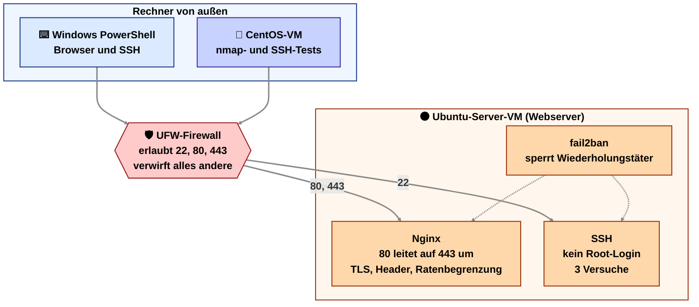
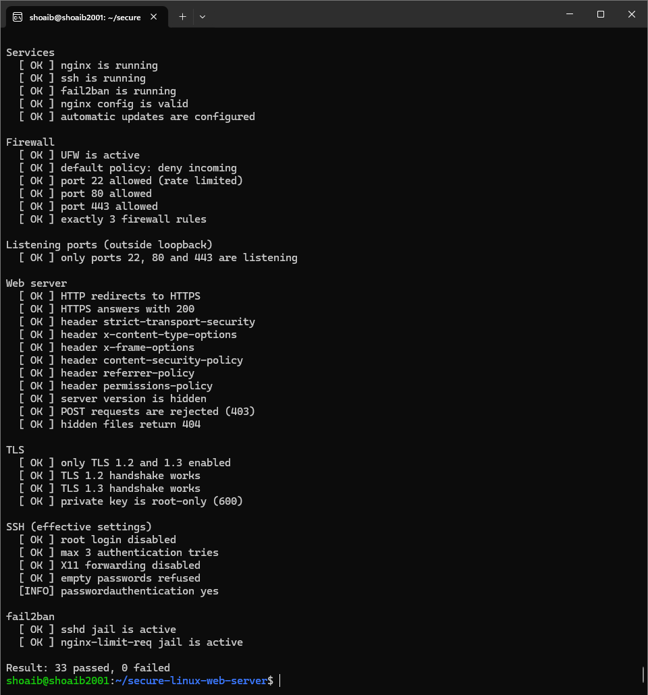
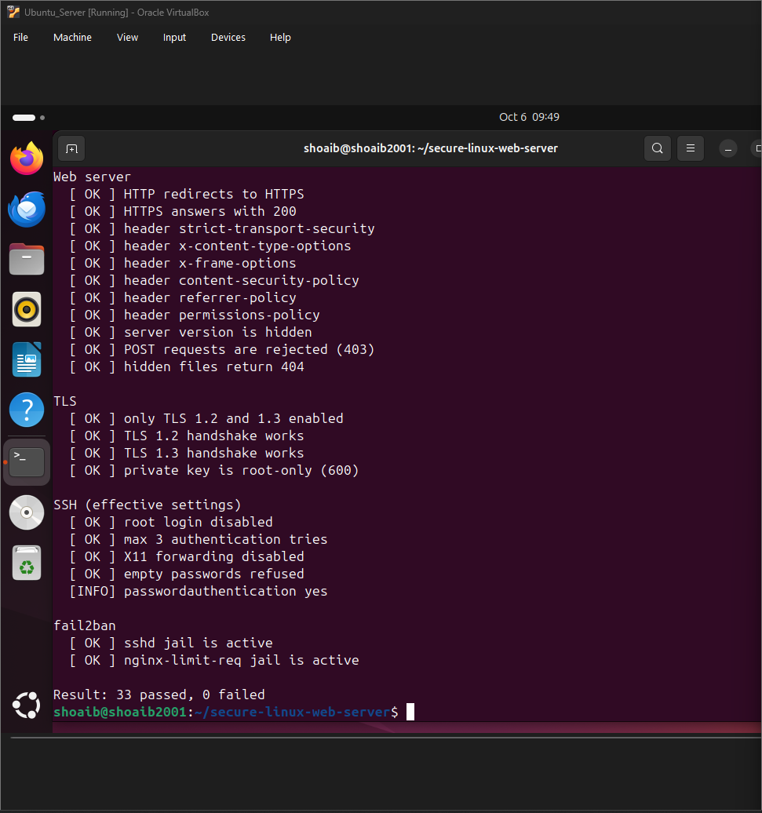
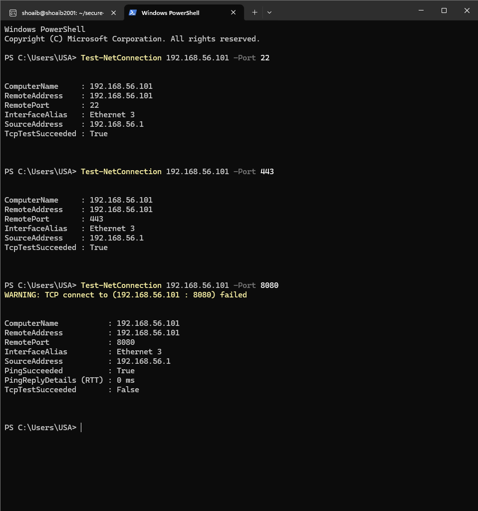
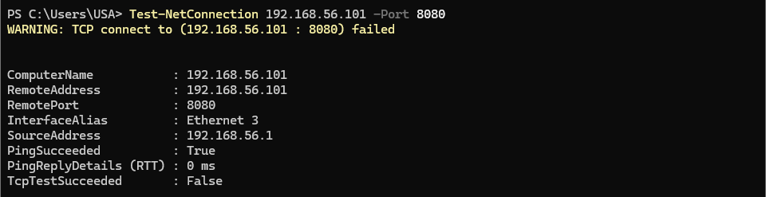
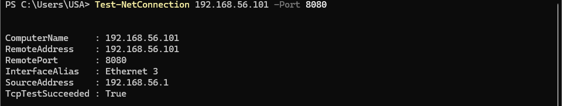
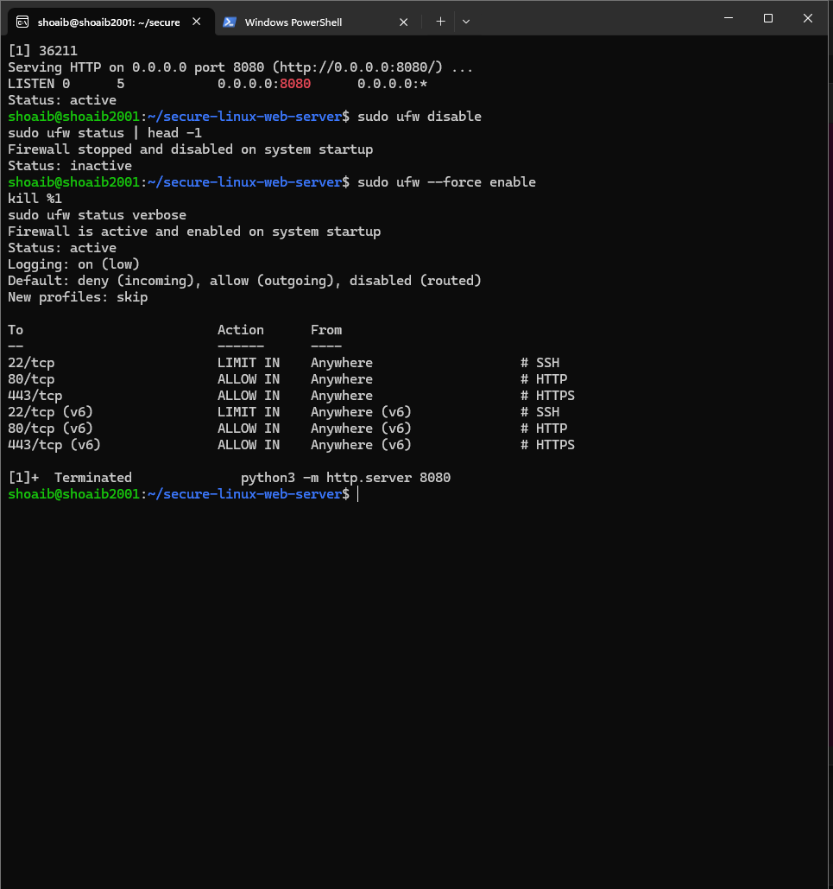
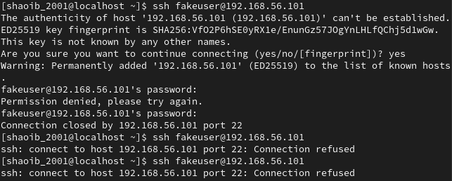
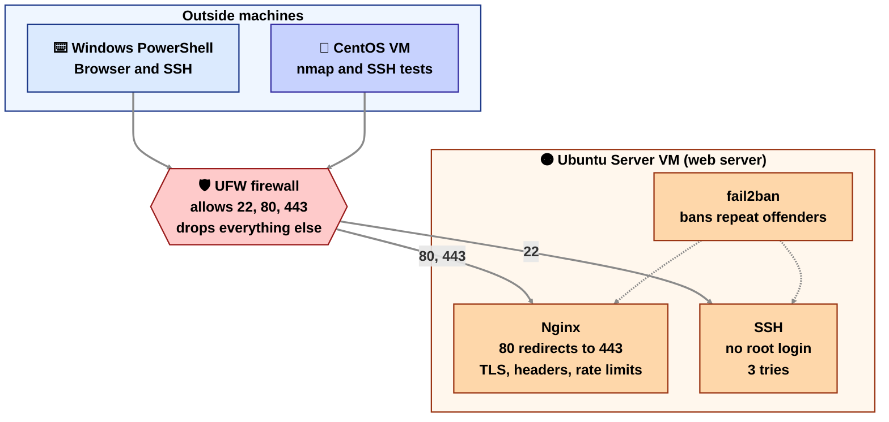

# Secure Linux Web Server

Sprache wählen / Choose a language

<details open name="language">
<summary><b>Deutsch</b></summary>

Ich betreibe einen Nginx-Webserver auf Ubuntu Server in meinem VirtualBox-Homelab. Er liefert eine Seite über HTTPS aus. Eine UFW-Firewall lässt nur SSH (22), HTTP (80) und HTTPS (443) durch, und SSH, Nginx und das System sind gehärtet. Die zweite VM (CentOS) dient als Rechner von außen zum Testen.

## Architektur



## Inhalt des Repositorys

```text
secure-linux-web-server/
├── README.md
├── docs/
│   └── security-hardening.md           alle Härtungsschritte mit Begründung
├── nginx/
│   ├── nginx.conf                      Hauptkonfiguration
│   ├── sites-available/secure-site.conf  Site mit HTTPS und Ratenbegrenzung
│   ├── snippets/ssl-params.conf        TLS-Einstellungen
│   ├── snippets/security-headers.conf  Sicherheits-Header
│   └── html/                           Testseite
├── firewall/ufw-setup.sh               UFW-Regeln
├── ssh/                                sshd-Konfiguration
├── fail2ban/jail.local                 fail2ban-Jails
└── scripts/
    ├── setup.sh                        installiert und konfiguriert alles
    └── verify.sh                       prüft das Ergebnis
```

## Was das Setup macht

| Bereich | Maßnahmen |
|---|---|
| Firewall | UFW sperrt alles Eingehende und erlaubt nur 22 (mit Ratenbegrenzung), 80 und 443 |
| Webserver | HTTPS mit TLS 1.2 und 1.3, HTTP leitet auf HTTPS um, Version versteckt, Sicherheits-Header, Ratenbegrenzung, nur GET und HEAD |
| SSH | kein Root-Login, höchstens 3 Versuche, Leerlauf-Sitzungen werden beendet, optional nur Anmeldung per Schlüssel |
| Angriffsschutz | fail2ban sperrt wiederholte SSH-Fehlversuche und Missbrauch der Ratenbegrenzung |
| System | automatische Sicherheitsupdates, nur nötige Pakete, Webverzeichnis für Nginx nur lesbar |

Die vollständige Liste mit Begründungen steht in [docs/security-hardening.md](docs/security-hardening.md).

## Schnellstart

Voraussetzungen: Ubuntu Server 22.04 oder 24.04, Internetzugang über den NAT-Adapter und ein zweiter Adapter als Host-only.

1. Host-only-Adapter hinzufügen. Die VM ausschalten, dann in VirtualBox unter Settings, Network, Adapter 2 bei "Attached to" die Option "Host-only Adapter" wählen. VM starten und die Adresse mit `ip -br a` ablesen, zum Beispiel `192.168.56.101`. Falls der zweite Adapter keine Adresse bekommt, prüfen, ob unter File, Tools, Network Manager der DHCP-Server für das Host-only-Netz aktiv ist. Für einen schnellen Test hilft `sudo dhclient enp0s8`; dauerhaft gehört der Adapter mit `dhcp4: true` in eine Datei unter `/etc/netplan/`.

2. Den Code auf die VM holen.

   ```bash
   sudo apt install -y git
   git clone https://github.com/shoaib-abdul-haleem/secure-linux-web-server.git
   cd secure-linux-web-server
   ```

3. Das Setup ausführen.

   ```bash
   sudo bash scripts/setup.sh
   ```

4. Das Ergebnis prüfen.

   ```bash
   sudo bash scripts/verify.sh
   ```

5. Im Browser unter Windows `https://192.168.56.101/` öffnen (eigene Adresse einsetzen) und die Warnung wegen des selbst signierten Zertifikats bestätigen.

### Optional: SSH-Schlüssel einrichten und Passwort-Login abschalten

In Windows PowerShell:

```powershell
ssh-keygen -t ed25519
type $env:USERPROFILE\.ssh\id_ed25519.pub | ssh username@192.168.56.101 "mkdir -p ~/.ssh && chmod 700 ~/.ssh && tr -d '\r' >> ~/.ssh/authorized_keys && chmod 600 ~/.ssh/authorized_keys"
ssh username@192.168.56.101
```

Der letzte Login muss ohne Passwortabfrage klappen. Erst dann auf der VM ausführen:

```bash
sudo bash scripts/setup.sh --disable-ssh-passwords
```

Das Skript bricht ab, wenn für den Benutzer kein Schlüssel hinterlegt ist, damit man sich nicht aussperrt.

### Tests

Von Windows PowerShell:

```powershell
Test-NetConnection 192.168.56.101 -Port 22
Test-NetConnection 192.168.56.101 -Port 443
Test-NetConnection 192.168.56.101 -Port 8080
```

Die ersten beiden müssen gelingen. Der Test auf 8080 muss scheitern, solange kein Dienst dort erreichbar sein darf.

Von der CentOS-VM aus (dort ebenfalls Adapter 2 auf Host-only stellen):

```bash
sudo dnf install -y nmap
nmap -Pn -p 1-1000,8080 192.168.56.101
```

Erwartet: 22, 80 und 443 sind `open`, alle anderen Ports sind `filtered`.

Beweis, dass die Firewall der Grund ist: Auf dem Webserver in einem zweiten Terminal einen Dienst auf Port 8080 starten, der nicht erlaubt ist.

```bash
python3 -m http.server 8080
```

Der nmap-Scan von der CentOS-VM zeigt 8080 als `filtered`. Danach auf dem Webserver `sudo ufw disable` ausführen und erneut scannen: 8080 ist jetzt `open`. Mit `sudo ufw enable` die Firewall wieder einschalten und den Python-Dienst mit `Ctrl+C` beenden. Dasselbe zeigt `Test-NetConnection 192.168.56.101 -Port 8080` von Windows aus: `False` mit Firewall, `True` ohne.

Sperre durch fail2ban testen (vor dem Abschalten des Passwort-Logins): Von der CentOS-VM mit `ssh falscher-benutzer@192.168.56.101` dreimal ein falsches Passwort eingeben. Auf dem Webserver zeigt `sudo fail2ban-client status sshd` die gesperrte Adresse. Entsperren mit `sudo fail2ban-client set sshd unbanip <Adresse>`.

## Testergebnisse

Getestet auf Ubuntu 24.04 in VirtualBox. Windows und die CentOS-VM greifen von außen zu.

**1. Alle Prüfungen bestanden.** `scripts/verify.sh` meldet 33 bestanden, 0 fehlgeschlagen.



**2. Nach einem Neustart der VM.** Das Ergebnis ist dasselbe, die Dienste starten von selbst.



**3. Offene und gesperrte Ports.** Von Windows PowerShell aus sind 22 und 443 erreichbar, 8080 nicht.



**4. Die Firewall ist der Grund.** Auf dem Webserver läuft ein Test-Dienst auf Port 8080. Mit eingeschalteter Firewall scheitert die Verbindung von Windows:



Nach `sudo ufw disable` gelingt dieselbe Verbindung:



Auf dem Webserver sieht man den Ablauf. Der Dienst hört auf 8080, die Firewall wird aus- und wieder eingeschaltet, und am Ende gelten wieder die drei Regeln für 22, 80 und 443.



**5. fail2ban.** Nach wiederholten falschen Passwörtern von der CentOS-VM verweigert der Webserver neue SSH-Verbindungen (`Connection refused`).



## Grenzen

- Das Zertifikat ist selbst signiert, deshalb zeigt der Browser eine Warnung. Mit einer echten Domain würde ich Let's Encrypt verwenden.
- Ausgehender Verkehr ist erlaubt, weil Updates ihn brauchen. Ping wird weiterhin beantwortet.
- Es ist ein Lab auf einem privaten Netz. Für einen Server im Internet kämen Überwachung, Backups und eine echte Domain dazu.

</details>

<details name="language">
<summary><b>English</b></summary>

I run an Nginx web server on Ubuntu Server in my VirtualBox home lab. It serves a page over HTTPS. A UFW firewall lets in only SSH (22), HTTP (80) and HTTPS (443), and SSH, Nginx and the system are hardened. The second VM (CentOS) acts as the outside machine for testing.

## Architecture



## Repository contents

```text
secure-linux-web-server/
├── README.md
├── docs/
│   └── security-hardening.md           every hardening step with the reason
├── nginx/
│   ├── nginx.conf                      main configuration
│   ├── sites-available/secure-site.conf  site with HTTPS and rate limits
│   ├── snippets/ssl-params.conf        TLS settings
│   ├── snippets/security-headers.conf  security headers
│   └── html/                           test page
├── firewall/ufw-setup.sh               UFW rules
├── ssh/                                sshd configuration
├── fail2ban/jail.local                 fail2ban jails
└── scripts/
    ├── setup.sh                        installs and configures everything
    └── verify.sh                       checks the result
```

## What the setup does

| Area | Measures |
|---|---|
| Firewall | UFW blocks all incoming traffic and allows only 22 (rate limited), 80 and 443 |
| Web server | HTTPS with TLS 1.2 and 1.3, HTTP redirects to HTTPS, hidden version, security headers, rate limits, only GET and HEAD |
| SSH | no root login, at most 3 tries, idle sessions closed, optional key-only login |
| Intrusion protection | fail2ban bans repeated failed SSH logins and abuse of the rate limit |
| System | automatic security updates, only the packages needed, web root read-only for Nginx |

The full list with reasons is in [docs/security-hardening.md](docs/security-hardening.md).

## Quick start

Requirements: Ubuntu Server 22.04 or 24.04, internet access through the NAT adapter, and a second adapter set to Host-only.

1. Add a Host-only adapter. Power off the VM, then in VirtualBox open Settings, Network, Adapter 2 and set "Attached to" to "Host-only Adapter". Start the VM and read its address with `ip -br a`, for example `192.168.56.101`. If the second adapter gets no address, check that the DHCP server for the Host-only network is enabled under File, Tools, Network Manager. For a quick test, `sudo dhclient enp0s8` works; to make it permanent, add the adapter with `dhcp4: true` to a file in `/etc/netplan/`.

2. Get the code onto the VM.

   ```bash
   sudo apt install -y git
   git clone https://github.com/shoaib-abdul-haleem/secure-linux-web-server.git
   cd secure-linux-web-server
   ```

3. Run the setup.

   ```bash
   sudo bash scripts/setup.sh
   ```

4. Check the result.

   ```bash
   sudo bash scripts/verify.sh
   ```

5. On Windows, open `https://192.168.56.101/` in a browser (use your own address) and accept the warning about the self-signed certificate.

### Optional: set up SSH keys and turn off password login

In Windows PowerShell:

```powershell
ssh-keygen -t ed25519
type $env:USERPROFILE\.ssh\id_ed25519.pub | ssh username@192.168.56.101 "mkdir -p ~/.ssh && chmod 700 ~/.ssh && tr -d '\r' >> ~/.ssh/authorized_keys && chmod 600 ~/.ssh/authorized_keys"
ssh username@192.168.56.101
```

The last login must work without a password prompt. Only then run this on the VM:

```bash
sudo bash scripts/setup.sh --disable-ssh-passwords
```

The script stops if the user has no key installed, so you cannot lock yourself out.

### Tests

From Windows PowerShell:

```powershell
Test-NetConnection 192.168.56.101 -Port 22
Test-NetConnection 192.168.56.101 -Port 443
Test-NetConnection 192.168.56.101 -Port 8080
```

The first two must succeed. The test on 8080 must fail, because nothing is allowed to be reachable there.

From the CentOS VM (set its Adapter 2 to Host-only as well):

```bash
sudo dnf install -y nmap
nmap -Pn -p 1-1000,8080 192.168.56.101
```

Expected: ports 22, 80 and 443 are `open`, every other port is `filtered`.

Proof that the firewall is the reason: on the web server, start a service on port 8080 in a second terminal. It is not allowed through.

```bash
python3 -m http.server 8080
```

The nmap scan from the CentOS VM shows 8080 as `filtered`. Then run `sudo ufw disable` on the web server and scan again: 8080 is now `open`. Turn the firewall back on with `sudo ufw enable` and stop the Python service with `Ctrl+C`. `Test-NetConnection 192.168.56.101 -Port 8080` from Windows shows the same: `False` with the firewall, `True` without.

To test the fail2ban ban (before turning off password login): from the CentOS VM run `ssh wronguser@192.168.56.101` and enter a wrong password three times. On the web server, `sudo fail2ban-client status sshd` shows the banned address. Remove the ban with `sudo fail2ban-client set sshd unbanip <address>`.

## Test results

Tested on Ubuntu 24.04 in VirtualBox. Windows and the CentOS VM connect from outside.

**1. All checks passed.** `scripts/verify.sh` reports 33 passed, 0 failed.


**2. After restarting the VM.** The result is the same, the services start by themselves.


**3. Open and blocked ports.** From Windows PowerShell, ports 22 and 443 are reachable and 8080 is not.


**4. The firewall is the reason.** A test service runs on port 8080 on the web server. With the firewall on, the connection from Windows fails:


After `sudo ufw disable`, the same connection succeeds:


On the web server you can see the sequence. The service listens on 8080, the firewall is turned off and on again, and at the end the three rules for 22, 80 and 443 apply again.


**5. fail2ban.** After repeated wrong passwords from the CentOS VM, the web server refuses new SSH connections (`Connection refused`).


## Limits

- The certificate is self-signed, so the browser shows a warning. With a real domain I would use Let's Encrypt.
- Outgoing traffic is allowed because updates need it. Ping is still answered.
- This is a lab on a private network. A server on the internet would also need monitoring, backups and a real domain.

</details>
